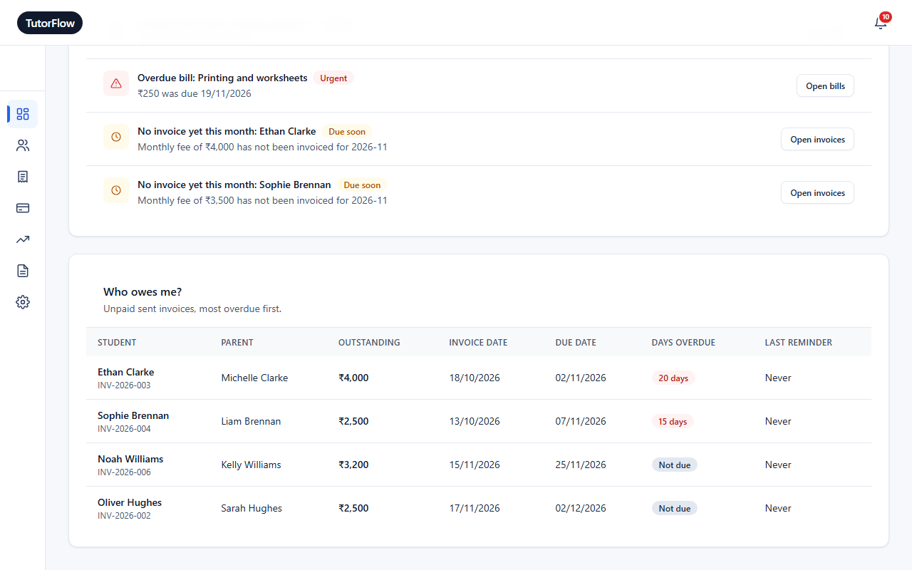
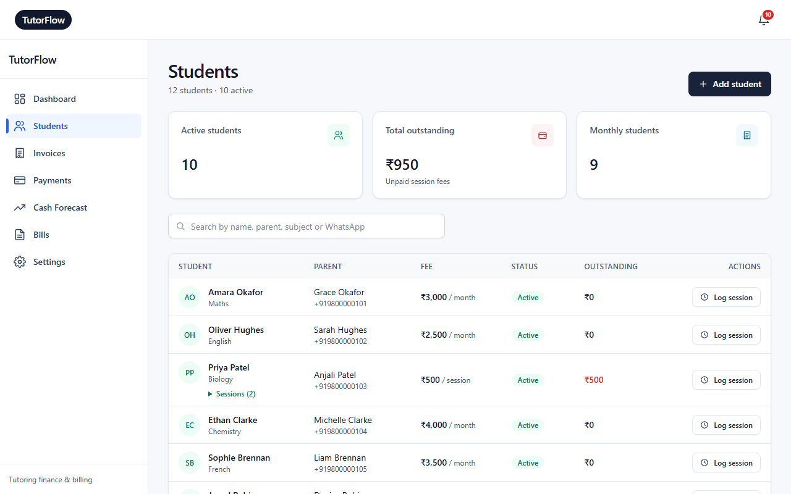
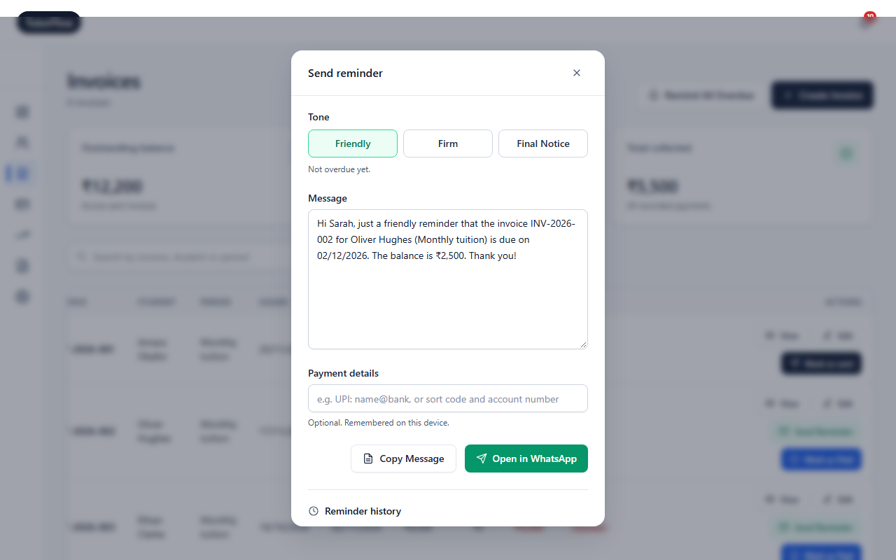
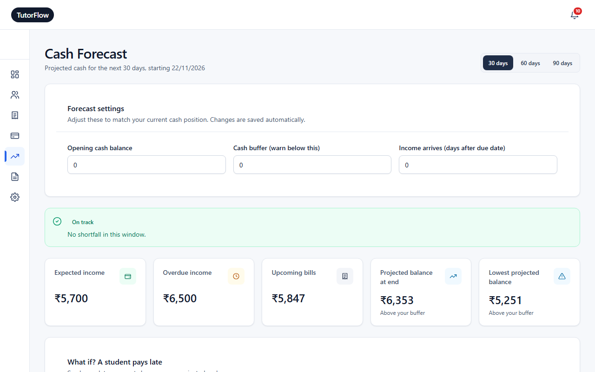
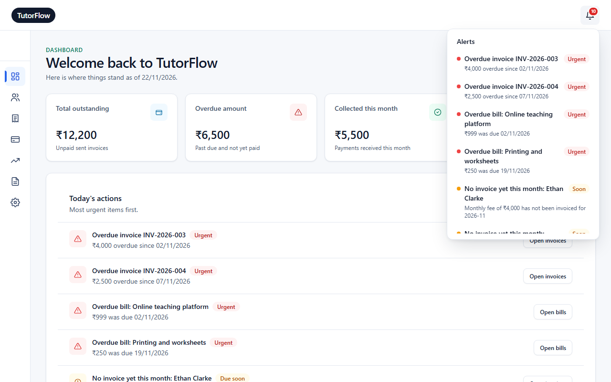

# TutorFlow

A back-office app for solo home tutors. Track students, invoices, payments, bills and cash flow in one place, with a 30/60/90-day cash forecast and simple follow-up tools.

Built for the CodeBenders Ace Builders Hackathon 2026.

## Problem

Solo home tutors often run their business from memory, messages and spreadsheets. They lose track of who has paid, who owes money and for how long, and whether next month's bills are covered.

## Solution

TutorFlow keeps students, invoices, payments and bills in one browser-based app. The dashboard shows who owes money and since when. The cash forecast projects the next 30, 60 or 90 days using expected invoice income and upcoming bills. Alerts and reminders help the tutor act on overdue balances.

## Features

- **Students:** add students with subject, parent contact, fee type and fee amount; see active and total counts.
- **Invoices and payments:** create invoices, record payments (partial payments are supported, with the remaining balance shown), and see status labels such as Sent, Partially Paid, Overdue and Paid.
- **Follow-ups:** send a payment reminder with a chosen tone (Friendly, Firm or Final Notice), copy the message or open it in WhatsApp, and keep a reminder history per invoice.
- **Dashboard:** total outstanding, overdue amount, collected this month and expected income in the next 30 days, plus a "Who owes me?" table with outstanding amount, due date, days overdue and last reminder.
- **Bills:** track upcoming and overdue bills.
- **Cash forecast:** 30, 60 and 90-day views combining expected invoice income, overdue income, upcoming bills and projected balance.
- **What-if scenario:** pick a student and a payment delay (0 to 30 days) to see how it changes the projected balance and whether a cash shortfall appears.
- **Alerts:** notifications for overdue invoices, overdue bills and missing monthly invoices, each linking to the related page.
- **Settings:** light, dark or system theme; six accent palettes; business profile and invoice branding; default currency display (INR, USD, EUR); date format; notification preferences; JSON backup export and validated import; reset to demo data with a typed confirmation. Import and reset each keep their own timestamped backup, so earlier backups are never overwritten.

## Tech stack

- React 18 and Vite
- Tailwind CSS
- Browser localStorage for all data (no backend, no account)

## Setup

Requirements: Node.js 18 or later and npm.

    npm install
    npm run dev

Open the URL that Vite prints (usually http://localhost:5173).

To create a production build:

    npm run build
    npm run preview

## Data and privacy

All data is stored in this browser's localStorage and is not sent to a server. Clearing browser data erases it, so export a backup from Settings > Data Management regularly. The app starts with sample data so every page has content to explore.

## Live demo

Live demo: https://tutor-flow-rose.vercel.app

The live site is a deployed build and may not include the most recent local changes. Run the app locally with `npm run dev` for the latest version.

## Screenshots

### Dashboard: who owes me

### Students

### Invoices with Send Reminder

### Cash forecast with what-if scenario

### Alerts dropdown

## Known limitations

- Single-browser, single-user app. Data does not sync between devices.
- Currency changes only how amounts are displayed. Stored amounts are never converted.
- Hindi and Telugu are shown as planned and are not yet available. English is the only language.
- Sending a reminder opens WhatsApp or copies the message; the app does not send messages itself.

## Future improvements

- Cloud sync and sign-in for use across devices.
- Hindi and Telugu translations.
- Bulk invoice generation for recurring monthly fees.
- Automatic archiving of paid records after a set period.
